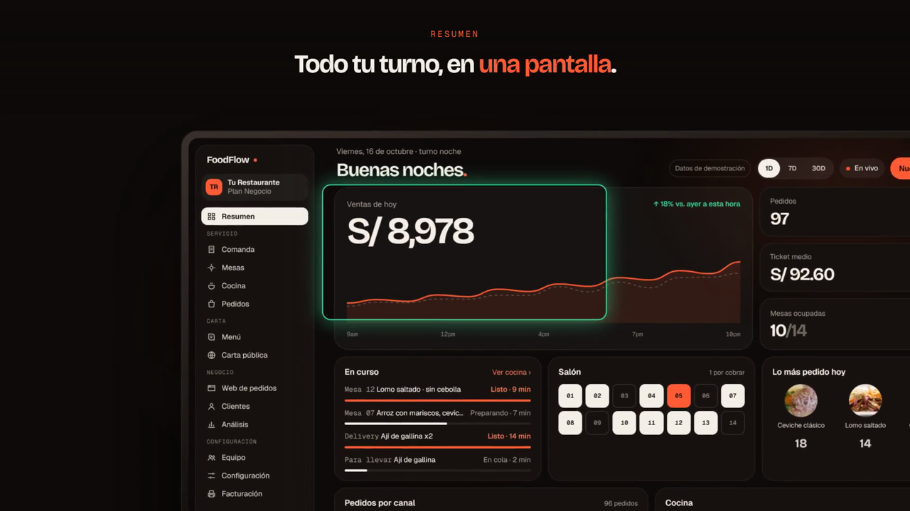

<div align="center">

# FoodFlow

### Tu restaurante funcionando en 48 horas. Sin comisión por pedido.

Carta con QR, pedidos, cocina, mesas y los números del turno, en un solo panel.<br>
Hecho en Lima, para restaurantes de Lima.

[](https://foodflow.site)
[](https://foodflow.site/precios)
[](https://foodflow.site)

[**Ver demo**](https://foodflow.site) · [**Planes**](https://foodflow.site/precios) · [**Calculadora de comisiones**](https://foodflow.site/calculadora) · [**WhatsApp**](https://wa.me/51950360685)

<a href="https://foodflow.site">
  
</a>

</div>

---

## El problema, en una línea

Pedidos que se pierden entre WhatsApp, llamadas y un cuaderno. Una carta que cuesta reimprimir. Una comisión de **20% a 35%** por cada pedido que las apps de delivery te traen, y un cliente que nunca llega a ser tuyo.

## La solución, en un panel

| | |
|---|---|
| **Carta digital con QR** | Cambia un precio, marca un plato agotado y se actualiza en todas las mesas al instante. Un QR por mesa. |
| **Pedidos en una sola cola** | Salón, para llevar y delivery entran a cocina con su prioridad ya puesta. |
| **Comanda para mozos** | Toman el pedido desde el celular y envían cada ronda a cocina en pocos toques. Cada quien entra con su propia cuenta. |
| **Pantalla de cocina** | Pendiente, en preparación y listo, con notas, rondas y el tiempo que lleva esperando cada pedido. |
| **Mesas y reservas** | Plano de tu salón, mesas ocupadas, reservas y cada cuenta ligada a su mesa. |
| **Tu web de pedidos** | Tu nombre, tu carta, tus precios. El cliente compra directo y el cobro va a tu cuenta. |
| **Los números del turno** | Ventas, pedidos, canales y tiempos de cocina mientras el servicio sigue en marcha. |

> No necesitas comprar hardware: funciona en los celulares, tablets y computadoras que ya tienes.

## Cómo funciona un pedido

```
  📱 El comensal            🍳 La cocina               📊 Tú, el dueño
  escanea el QR,     ──▶    lo ve al instante,  ──▶    lo ves vendido y
  elige y envía             ordenado por tiempo        la mesa libre
```

Sin descargar nada, sin esperar al mozo y sin que nadie camine con un papel.

## Sin comisión por pedido

Las plataformas se quedan con un porcentaje de cada venta. FoodFlow cobra una **cuota mensual fija**: vendas S/ 5,000 o S/ 50,000, pagas lo mismo. El pedido entra directo a tu panel y la relación con el cliente sigue siendo tuya.

Compártelo en Instagram, Google o WhatsApp. Tus clientes no instalan nada.

[**Haz la cuenta con tus números →**](https://foodflow.site/calculadora)

## Planes

| | **Carta** | **Servicio** · *el más elegido* | **Negocio** |
|---|---|---|---|
| **Precio** | S/ 69 /mes + IGV | S/ 169 /mes + IGV | S/ 339 /mes + IGV |
| **Para** | Tener la carta digital lista hoy | El que usan la mayoría | Crecer o tener varios locales |
| **Incluye** | Carta digital y un QR por mesa · 1 local, 1 usuario | Todo lo de Carta · comanda · cocina · plano de mesas y reservas · hasta 10 usuarios | Todo lo de Servicio · tu web de pedidos · varios locales en un panel · soporte prioritario |

Los tres: **0% de comisión por pedido**, soporte en español e inglés, actualizaciones incluidas y **sin permanencia** (cambias o cancelas de un mes a otro). Optimizado para que tus clientes paguen con Yape, Plin o efectivo. La primera suscripción incluye 7 días de prueba; el checkout te muestra cuándo se hace el primer cobro.

[**Ver los planes completos →**](https://foodflow.site/precios)

## Programa fundador · Lima

Plazas limitadas para restaurantes de Lima:

- 💸 **Precio de fundador congelado de por vida** (–10%)
- 🍽️ **Migración de tu carta gratis**: la digitamos y montamos nosotros, tú no haces nada
- 🤝 **Acompañamiento en vivo** durante tu primer viernes de servicio

Montamos tu carta, tus canales de pedido, la pantalla de cocina, tus mesas y tus QR. Tú abres el turno.

[**Reservar mi plaza →**](https://foodflow.site) · [**Escribir por WhatsApp →**](https://wa.me/51950360685)

## ¿Es para ti?

Si eres restaurante, cevichería, cafetería o local de comida y:

- ✅ recibes pedidos por varios canales y quieres ordenarlos;
- ✅ tienes mesas y necesitas una comanda simple para tu equipo;
- ✅ quieres actualizar tu carta sin depender de un diseñador;
- ✅ prefieres vender directo y no regalar un porcentaje de cada plato;
- ✅ quieres ver qué pasa durante el turno, no tres días después.

## Preguntas rápidas

<details>
<summary><b>¿Puedo seguir usando Rappi u otras plataformas?</b></summary>

Sí. FoodFlow suma un canal propio; no tienes que apagar los que ya tienes para empezar a vender directo.
</details>

<details>
<summary><b>¿Cuánto demora ponerlo en marcha?</b></summary>

El piloto está pensado para dejar tu operación lista en 48 horas, con la carga inicial de tu carta incluida.
</details>

<details>
<summary><b>¿Hay permanencia o penalidad si me quiero ir?</b></summary>

No. Si te vas, te exportamos todo: tus datos siempre son tuyos.
</details>

<details>
<summary><b>¿Los precios incluyen IGV?</b></summary>

No. Los precios publicados no incluyen IGV (18%). Emitimos boleta o factura a tu RUC.
</details>

<details>
<summary><b>¿Puedo probarlo antes de decidir?</b></summary>

Sí. Escríbenos y te mostramos el panel, revisamos cómo recibes pedidos hoy y te decimos qué plan tiene sentido para tu local.
</details>

[Todas las preguntas frecuentes →](https://foodflow.site/preguntas)

## Empieza por una conversación de 20 minutos

Cuéntanos cómo funciona hoy tu restaurante. Vemos dónde se pierden pedidos, cuánto te cuestan las comisiones y qué parte de FoodFlow conviene activar primero.

<div align="center">

[**Solicitar información**](https://foodflow.site) · [**WhatsApp**](https://wa.me/51950360685) · [**Calculadora**](https://foodflow.site/calculadora)

</div>

---

<div align="center">

© FoodFlow · Lima, Perú

[Privacidad](https://foodflow.site/privacidad) · [Términos](https://foodflow.site/terminos) · [Libro de Reclamaciones](https://foodflow.site/libro-de-reclamaciones)

</div>
